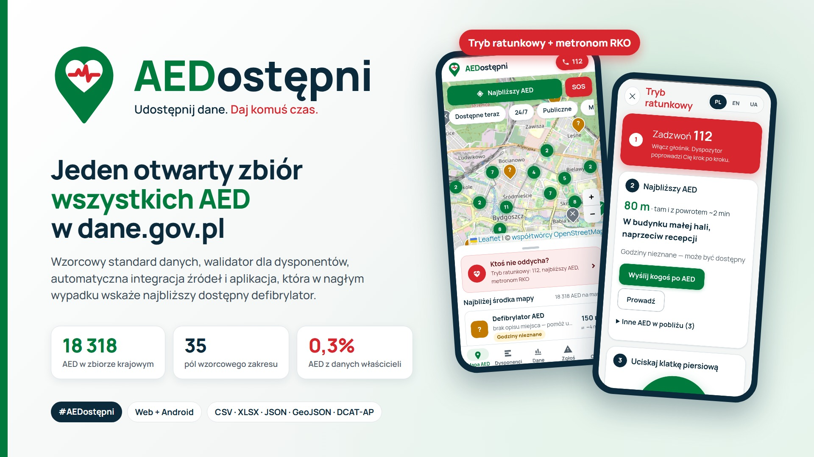

# AEDostępni — Udostępnij dane. Daj komuś czas.



Rozwiązanie na **HackNation 2026**, wyzwanie **„Misja AED — Dane na ratunek”** (Ministerstwo Cyfryzacji, dane.gov.pl).

**AEDostępni** to otwarty system, który zbiera rozproszone dane o defibrylatorach AED w jeden aktualny zbiór krajowy w dane.gov.pl, oraz akcja, która zachęca właścicieli AED do publikowania danych według wspólnego standardu.

| | |
|---|---|
| 🌐 **Strona (działa online i offline)** | https://mateuszl28.github.io/HackNation2026_AED1/ |
| 📱 **Aplikacja Android** | [pobierz najnowszą wersję (APK)](https://github.com/Mateuszl28/HackNation2026_AED1/releases/latest/download/AEDostepni.apk) · [wydania](https://github.com/Mateuszl28/HackNation2026_AED1/releases) |
| 📊 **Dane** | [CSV](https://mateuszl28.github.io/HackNation2026_AED1/data/aed.csv) · [JSON](https://mateuszl28.github.io/HackNation2026_AED1/data/aed.json) · [GeoJSON](https://mateuszl28.github.io/HackNation2026_AED1/data/aed.geojson) · [XLSX](https://mateuszl28.github.io/HackNation2026_AED1/data/aed.xlsx) · [DCAT-AP](https://mateuszl28.github.io/HackNation2026_AED1/data/dcat.xml) — aktualizowane co noc |
| 📐 **Wzorcowy zakres danych** | [`standard/aed-wzorcowy-zakres-danych.xlsx`](standard/aed-wzorcowy-zakres-danych.xlsx) · [`datapackage.json`](standard/datapackage.json) |
| 🎨 **Logo i księga znaku** | [`brand/logo/`](brand/logo) (SVG/PNG/JPG/PDF) · [`brand/ksiega-znaku.pdf`](brand/ksiega-znaku.pdf) |

## Problem, który rozwiązujemy

Przy nagłym zatrzymaniu krążenia każda minuta bez defibrylacji zmniejsza szanse przeżycia. Świadek musi wiedzieć, **gdzie jest najbliższy AED, czy jest dostępny teraz i czy działa** — a dziś te informacje są rozproszone:

- **18 320 AED** zna mapa społecznościowa OpenStreetMap, ale **tylko 0,3%** jest potwierdzonych danymi od właścicieli;
- **63%** nie ma godzin dostępności, **67%** nie ma daty kontroli;
- w dane.gov.pl są **4 zbiory gmin**, każdy w innym formacie i z błędami, które wykrył nasz pipeline:
  - **Marki:** plik zrobiony na szablonie z Krosna — szkoła w Markach ma współrzędne krośnieńskiej pływalni (293 km), zamienione kolumny współrzędnych, zdublowane pinezki;
  - **Przemyśl:** niestandardowa geometria `{lat, long}` zamiast GeoJSON;
  - **Warszawa:** zasób opisany jako JSON prowadzi do strony WWW, nie do pliku z danymi;
  - **Legionowo:** AED schowane jako zasób ogólnego zbioru „Zdrowie”;
- tylko **5 z 380 powiatów** ma jakikolwiek zbiór AED od właściciela.

## Co zbudowaliśmy

### Dla dysponentów AED (gminy, szpitale, firmy, uczelnie)
- **Wzorcowy zakres danych — 35 pól** (lokalizacja WGS84, dokładne miejsce, godziny w składni `opening_hours`, zabezpieczenie szafki, stan, ważność elektrod/baterii, dysponent z REGON), zgodny z TERYT, ISO 8601 i tagami OpenStreetMap.
- **Walidator w przeglądarce** (plik nie opuszcza komputera): wgraj CSV/XLSX/ODS/JSON/GeoJSON w dowolnym układzie → automatyczne dopasowanie kolumn → naprawa typowych błędów → wykrycie punktów skopiowanych z innego miejsca → pliki CSV/XLSX/JSON + metadane (JSON i **DCAT-AP** do harvestingu) gotowe do dane.gov.pl.
- **„Sprawdź, co już wiemy o Twoich AED”** — wyszukiwanie po nazwie lub powiecie, luki w danych i **wstępnie wypełniony plik XLSX** do uzupełnienia.
- **Naklejki „Tu jest AED” z kodem QR** do karty urządzenia (zgłaszanie usterek przez mieszkańców).
- **Przypomnienia serwisowe** (kalendarz `.ics`): wymiana elektrod i baterii, coroczna kontrola.
- **Raport dla samorządu** (do druku/PDF): stan danych AED w powiecie, miejsce w rankingu, lista AED do uzupełnienia.

### Dla każdego — aplikacja web i Android
- Mapa 18 tys. AED, **„Najbliższy AED”** dostępny teraz z **trasą pieszą** i rzeczywistym czasem dojścia, filtry (dostępne teraz / 24/7 / publiczne), wyszukiwarka, klastry pokazujące dostępność.
- **Tryb ratunkowy (SOS)** w językach **PL / EN / UA**: 112, najbliższy dostępny AED z przybliżonym adresem, **„Wyślij kogoś po AED”** (SMS/komunikator), **metronom RKO 110/min** z wibracją, ekran nie gaśnie.
- **Aktualna lokalizacja**: natywny GPS w aplikacji, odrzucanie zapamiętanych odczytów, okrąg dokładności.
- **Działa bez internetu** (dane w aplikacji; w wersji web — service worker).
- **Zgłoszenia i potwierdzenia stanu AED** — opcjonalnie jako notatki w OpenStreetMap (zamknięta pętla jakości bez własnego serwera).
- Android: skróty **SOS** i **Najbliższy AED** na ikonie, otwieranie linków i kodów QR w aplikacji, natywne udostępnianie, ekran powitalny.

### Dla akcji #AEDostępni
- Nazwa, hasło, logo, **księga znaku**, zestaw kampanii (plakat z QR, gotowe posty, pismo do dysponentów).
- **Mapa luk w danych** — ranking 16 województw i 380 powiatów wg indeksu gotowości danych.

### Dla deweloperów
- Stałe adresy plików, przykłady (curl / Python / JavaScript), Table Schema, stały identyfikator `aed_uid` — strona [`#/api`](https://mateuszl28.github.io/HackNation2026_AED1/#/api).

## Jak to działa

```
dane.gov.pl API ──► discover.ts ──► sources.auto.json ─┐
(zbiory i zasoby o AED,                                  │
 dysponent + REGON z metadanych)                         ▼
OpenStreetMap / OpenAEDMap ─────────────────────► pipeline/build.ts
                                                    │  mapowanie → naprawy → walidacja
                                                    │  → deduplikacja (35 m) → województwo/powiat
                                                    ▼
                          data/aed.{csv,json,geojson,xlsx}, dcat.xml, raporty
                                                    │
               GitHub Actions: co noc aktualizacja + commit + publikacja strony
                                                    ▼
                    Strona (GitHub Pages, PWA) i aplikacja Android (Capacitor)
```

Jedno źródło prawdy: `shared/schema.ts` (standard) i `shared/mapper.ts` (mapowanie, naprawy, walidacja) — ten sam kod działa w pipeline i w walidatorze w przeglądarce.

| Katalog | Zawartość |
|---|---|
| `shared/` | standard danych, silnik mapowania/walidacji, interpreter godzin, DCAT-AP, kalendarz serwisowy |
| `pipeline/` | wykrywanie zbiorów w dane.gov.pl, integracja, województwa i powiaty |
| `standard/` | generator wzorcowego zakresu danych (XLSX, CSV, Table Schema) |
| `web/` | aplikacja React + Leaflet (web/PWA) i projekt Android (Capacitor) |
| `brand/` | logo, ikony, księga znaku, okładka |
| `tests/` | testy jednostkowe silnika danych |
| `.github/workflows/` | CI (testy + build), nocna aktualizacja danych, publikacja strony |

## Uruchomienie

Wymagania: Node.js 24+ (pipeline uruchamia pliki `.ts` natywnie); dla Androida JDK 17 i Android SDK.

```bash
npm install
npm test                 # testy silnika danych
npm run standard         # wzorcowy zakres danych → standard/
npm run data             # integracja z kopii lokalnych → data/ i web/public/data/
npm run data:fetch       # wykrycie zbiorów w API dane.gov.pl + świeże dane OSM + integracja

cd web && npm install
npm run dev              # aplikacja web lokalnie
npm run build            # wersja produkcyjna (web/dist)
npx cap sync android && cd android && ./gradlew assembleDebug   # APK
```

## Jakość i zgodność

- **dane.gov.pl:** formaty odczytywalne maszynowo (CSV UTF-8, XLSX, JSON, GeoJSON), metadane DCAT-AP, licencje, kategoria „Zdrowie”, automatyczne wykrywanie przez API portalu.
- **WCAG 2.2 AA:** audyt axe-core na 12 ekranach — 0 naruszeń poza jednym ostrzeżeniem o nakładających się pinezkach (wyjątek kryterium 2.5.8; ta sama funkcja dostępna z listy). [Deklaracja dostępności](https://mateuszl28.github.io/HackNation2026_AED1/#/dostepnosc).
- **Testy:** 15 testów jednostkowych (godziny, CSV/GeoJSON, mapowanie, naprawy, walidacja, kontrole zbioru, DCAT-AP, kalendarz) uruchamianych w CI.
- **Prywatność:** brak kont, cookies, analityki i własnego serwera; lokalizacja nie jest gromadzona — do pokazania adresu i trasy pieszej przekazywana usługom OpenStreetMap (Nominatim, OSRM). [Polityka prywatności](https://mateuszl28.github.io/HackNation2026_AED1/#/prywatnosc).
- **Wydajność:** podział kodu (główna paczka 410 KB), pozostałe ekrany dociągane w tle do pamięci offline.

## Ograniczenia

- Kolejka weryfikacji zgłoszeń po stronie dysponenta wymaga backendu; dziś zgłoszenia trafiają do OpenStreetMap (notatki) i do zbioru dysponenta w dane.gov.pl (odnośnik).
- Część zbioru pochodząca z OpenStreetMap jest na licencji ODbL i musi ją zachować.
- Ok. 1% wpisów godzin to opisy słowne niemożliwe do interpretacji maszynowej (status „godziny nieznane”).
- Trasa piesza pochodzi z publicznego serwera OSRM (FOSSGIS) — bez internetu czas dojścia jest szacunkowy (linia prosta × 1,3); przybliżony adres pochodzi z geokodowania OSM.
- W budynku telefon często nie ma GPS, a pozycja z Wi-Fi bywa błędna (nawet inne miasto) — dlatego aplikacja pokazuje „Jesteś tu: adres” i pozwala wskazać miejsce ręcznie.
- Mapa (podkład OSM) wymaga internetu; dane AED, lista, nawigacja i tryb ratunkowy działają offline.

## Wykorzystanie AI

Zgodnie z §2 ust. 8 regulaminu: przy tworzeniu części kodu i materiałów graficznych zespół korzystał z asystenta AI. Analiza źródeł, projekt standardu danych, decyzje projektowe, weryfikacja i testy są pracą zespołu.

## Licencje

Kod: MIT. Standard danych i materiały akcji: CC BY 4.0. Dane: zgodnie z licencjami źródeł (dane.gov.pl; © współtwórcy OpenStreetMap — ODbL 1.0). Krój Manrope: SIL OFL 1.1.
